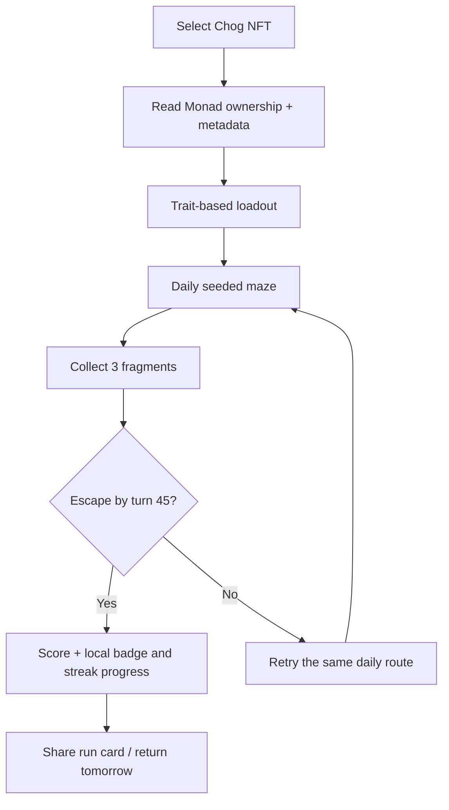
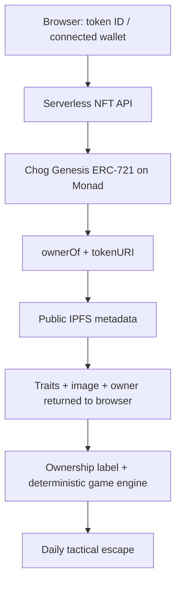

<div align="center">

# CHOG ESCAPE PROTOCOL

### YOUR NFT IS THE GAME.

**A daily tactical escape where your real Chog Genesis NFT determines your abilities, your stats, and the maze you face.**

Collect three signal fragments. Evade traps and drones. Reach the exit by turn **45**.

[**▶ Play the game**](https://chog-escape-protocol.vercel.app/) · [**View source**](https://github.com/0xNexuz/chog-escape-protocol) · [**Chogathon 2026**](https://chogathon.chog.xyz/)

*Built on Monad mainnet, powered by real Chog Genesis traits. No NFT is needed to try preview mode.*

</div>

## The challenge

Most NFT games can swap their token image for any other character without changing what the player does. **Chog Escape makes the NFT a game mechanic.**

A Chog's real metadata drives the loadout. Its identity seeds a deterministic maze that changes each UTC day. Switch NFTs and you can get a different power, different stats, and a different route.

Designed for **Chog holders** who want to play with their collectibles and **curious nonholders** who want a fast, free arcade challenge.

## Play in 30 seconds

1. Open [**Chog Escape Protocol**](https://chog-escape-protocol.vercel.app/).
2. Select **Fire Chog #973** to load its public metadata, then press **Start Preview Run**.
3. Move with **WASD**, **arrow keys**, or the on-screen directional controls.
4. Use **Space** or **Use Power** to activate **Firestorm**. Watch your health, power charges, and turns.
5. Collect **3 signal fragments**, avoid traps and chasing drones, and reach the lime exit by turn **45**.
6. Try **Laser Chog #533** to see different traits, powers, and a different daily maze.

**Own a Chog?** Connect an EVM wallet, enter its **onchain token ID**, and use **Verify & Play**. The game compares the connected address with `ownerOf(tokenId)` on Monad. Connecting and checking ownership require **no transaction or signature**. The label reflects a connected-address comparison, not a signed proof of wallet control.

> The number in an NFT's artwork/display name may differ from its onchain token ID. For example, onchain token **973** has been observed with the display name **CHOG #465**. Use the **token ID**, not the display name, when verifying ownership.

## Why the Chog NFT is essential

| NFT data | What it changes in the game |
| --- | --- |
| **Owner** (`ownerOf`) | Determines whether the connected wallet can enter owner-verified mode for that token. |
| **Aura** | Can unlock **Firestorm**, clearing nearby traps and stunning drones. |
| **Eyes** | Can unlock **Laser**, and influence how far the player sees. |
| **Body** | Influences the character's available hearts. |
| **Head** | Influences power-charge capacity. |
| **Token ID + traits** | Seed that NFT's reproducible daily maze. |

Chogs without the matching Fire Aura or Laser Eyes receive the **Phase** ability, allowing tactical movement two tiles ahead when a landing tile is open. The game calculates these effects from actual metadata; it does not assign arbitrary stats after the fact.

**The NFT is the key, the loadout, and the world seed.** Preview mode lets anyone explore these mechanics without pretending to own a token.

## The gameplay loop



Each maze contains obstacles, hazards, roaming drones, and three collectibles. Firestorm, Laser, and Phase offer different ways to handle danger. The layout stays reproducible for the same NFT and UTC day; **the day changes the challenge**.

### Controls

| Action | Desktop | Touch |
| --- | --- | --- |
| Move | WASD or arrow keys | On-screen directional controls |
| Use NFT power | Space | **Use Power** button |
| Restart | **Retry Route** | **Retry Route** |

## Monad integration: real NFTs, not decorative images

The serverless NFT API, [`api/nft.js`](api/nft.js), queries the **Chog Genesis** ERC-721 on Monad mainnet:

- **Chain ID:** `143`
- **Genesis contract:** [`0xc96d31f8626c6d03fae5dcd3d61e3fb9f4a73763`](https://opensea.io/item/monad/0xc96d31f8626c6d03fae5dcd3d61e3fb9f4a73763/973)
- **Public RPC:** `https://rpc.monad.xyz`
- **NFT methods:** `ownerOf(tokenId)` and `tokenURI(tokenId)`
- **Metadata:** public IPFS JSON and NFT artwork, with allowlisted trait fields



The wallet is used for an **address comparison only**. The current game does **not** require token transfers, onchain game transactions, private keys, or a paid API.

## Share, retry, return

- **Same token + same UTC date:** same generated daily maze, suitable for practicing a route.
- **Different token:** NFT identity and traits influence the map and loadout.
- **Next UTC day:** starting a new run uses the current UTC date and its seeded challenge.
- **Local progress:** completed runs, daily bests, gameplay-earned badges, and successful-run streaks are kept per token and run mode. Existing personal bests remain intact and are not converted into invented run records.
- **Share run card:** copyable text and a downloadable branded PNG include token ID, ability, fragments, date, score, turns, and run mode. The PNG uses locally drawn graphics, so external NFT art cannot block the download.

> Local personal bests are **not** global leaderboard entries or tamper-proof onchain scores. A public leaderboard, verified score receipts, and community tournaments are potential future directions, **not current features**.

## Run locally

Requires a recent Node.js version with built-in `fetch` support (Node.js **20+** recommended). No application runtime packages or API credentials are needed for the basic experience.

```bash
git clone https://github.com/0xNexuz/chog-escape-protocol.git
cd chog-escape-protocol
npm run dev
```

Open **http://localhost:3000**. The local server serves the frontend and the same NFT API route. Live metadata lookups require network access to Monad RPC and the public IPFS gateway.

## Testing and evidence

```bash
npm test
```

The updated automated suite passes **17 tests** covering trait-derived builds, 360 deterministic token/date/trait seeds with static routes of at most 38 turns, nine representative dynamic wins with moving drones, all three powers, collisions, energy, fragments, win/loss outcomes, invalid actions, local progress, and NFT API failures.

The [project context and verification record](docs/PROJECT_CONTEXT.md) documents live `ownerOf`/`tokenURI` lookups, public NFT metadata responses, and a browser preview that started a game and advanced its turn counter. **A complete browser win and owner-wallet path with a real holder have not been independently verified in that record.**

For judging, see the [**submission draft**](docs/SUBMISSION_DRAFT.md). A final hosted video link should be added here **only after it has actually been published and checked**.

## Known limitations

- **Preview is not proof of ownership.** It uses public NFT metadata while simulating access.
- The connected wallet's ownership is checked when a token is verified and rechecked without caching at the start of each verified run. Account and network changes clear verified mode. Ownership is **not continuously checked on every turn**.
- Scores and personal bests are browser-local and can be altered; there is no shared leaderboard or onchain score claim.
- Public RPC/IPFS performance can affect NFT loading; a sample fallback and its results are clearly labeled if live metadata is unavailable.
- This is a casual playable prototype, not a financial product or audited onchain gaming system.

## Hackathon disclosure and rights

Built for [**Chogathon 2026**](https://chogathon.chog.xyz/). Project-specific code was created during this hackathon work; the project draws on prior development experience but does not claim that third-party NFT images are original artwork.

The Chog Genesis art displayed by the application is retrieved from the tokens' public metadata and remains subject to its respective rights. **A repository-wide source-code license is not currently declared in a root `LICENSE` file.** Add one separately if you choose to license the code; NFT artwork rights should remain explicitly excluded from that license.
